# Awesome-Interactive-Presentation-Platform

  

  
  
  
  
  

---

## 🎯 Top Interactive Presentation Platform Ecosystem

> **Curated Directory of SaaS Solutions & High-Performance Open-Source GitHub Projects**  
> *Focused on Real-Time Audience Polling, Interactive Slide Decks, Markdown-to-Slides, Live Q&A, Gamified Quizzes & Modern Web Presentation Engines.*  
> **Last updated: November 2026**

Welcome to the definitive, SEO-optimized repository tracking cutting-edge **SaaS platforms** and **open-source frameworks** for **Interactive Presentation Platforms**. Whether you are an educator fostering classroom engagement, a conference keynote speaker running live audience polls, a developer advocate presenting executable code slides, or a product team building spatial visual decks—this guide indexes every battle-tested solution across the globe.

---

## 📑 Table of Contents
- [Sector Overview & Market Dynamics](#-sector-overview--market-dynamics)
- [SaaS / Hosted Platforms](#-saashosted-platforms)
- [Open-Source GitHub Projects](#-open-source-github-projects)
- [Key Architectural Archetypes](#-key-architectural-archetypes)
- [How to Choose a Platform](#-how-to-choose-a-platform)
- [Star History](#-star-history)
- [How to Contribute](#-how-to-contribute)
- [Support & Sponsorship](#-support--sponsorship)
- [Disclaimer](#-disclaimer)

---

## 🌐 Sector Overview & Market Dynamics

The global presentation and interactive visual engagement software market is estimated at **$8.5 billion to $9.2 billion**, accelerating at a strong compound annual growth rate (**CAGR of 12.5% to 13.9%**) toward an estimated **$25+ billion** over the next decade driven by AI-assisted slide creation and hybrid audience participation. The sector exhibits a **dual structure**: it is **moderately concentrated at the macro enterprise tier** by incumbent office ecosystems (Microsoft PowerPoint, Google Slides, Cisco), while remaining **highly fragmented and dynamically competitive across the interactive, AI-native, and developer-first niches** where specialized contenders (Canva, Mentimeter, Kahoot!, Pitch, and open-source engines) rapidly capture specialized audience share.

---

## ☁️ SaaS/Hosted Platforms

The table below catalogs premier hosted interactive presentation tools, sorted in **descending order by company scale** (market capitalization, recent valuation, or verified annual revenue scale).

| Platform | Company Scale (Valuation / Revenue) | Starting Paid Tier Pricing | Free Tier Limit / Free Trial Details | Core Interactive & Presenter Highlights |
| :--- | :--- | :--- | :--- | :--- |
| **[Slido (Cisco)](https://slido.com)** | **~$380B Market Cap** *(Parent: Cisco Systems; ~$56.7B Rev)* | **$12.50 / month** *($150/yr, Engage tier)* | **Free Forever Plan**: Capped at **100 participants per event**, maximum **3 polls per event**, and **1 quiz per event** (up to 30 questions). Unlimited audience Q&A. No exports or moderation. | Live Q&A crowdsourcing with upvoting, multi-choice polls, word clouds, quizzes, and native Webex, PowerPoint, and Google Slides integrations. |
| **[Canva Presentations](https://canva.com)** | **~$32B Valuation** *(~$4B Annual Recurring Revenue)* | **$15.00 / month** *($180/yr or $18/mo for Canva Pro)* | **Free Forever Plan**: Capped at **5 GB cloud storage**, 1 Brand Kit (3 colors only), standard templates/assets. **Canva Live** Q&A sessions supported. Transparent exports & premium assets locked. | Collaborative real-time design canvas, "Canva Live" audience interaction codes, rich multimedia animations, slide presenter notes, and interactive charts. |
| **[Zoho Present (Zoho Show)](https://zoho.com/show/)** | **~$12.5B Valuation** *(~$1.4B+ Consolidated Revenue)* | **$2.50 / user / month** *(billed annually via Zoho WorkDrive Starter)* | **Free Forever Plan**: **Unlimited presentations & slides**, up to **500 MB per file upload limit**, unlimited personal storage, real-time co-authoring, and mobile/TV broadcast casting. | Browser-based slide deck creation, live broadcast mode to remote screens, interactive shapes, fine-grained path animations, and team workspaces. |
| **[Kahoot!](https://kahoot.com)** | **~$1.7B Valuation** *(Acquired by Goldman Sachs consort.; ~$150M+ Rev)* | **$3.00 / month** *(~$36/yr, Kahoot!+ Bronze for teachers) / $19/mo (Pro Start business)* | **Free Forever Plan**: Strictly capped at **10 players per game** (Personal/Higher Ed) or **40 players** (K-12 educators). Business scratch games capped at **3 players**. Basic multiple-choice and True/False only. | Gamified live trivia competitions, timed quiz rounds, musical countdown lobbies, player podiums, and asynchronous mobile learning challenges. |
| **[Pitch](https://pitch.com)** | **~$600M Valuation** *(Series B; ~$8M–$10M ARR)* | **$13.00 / seat / month** *(billed annually for Plus) / $19/mo (Team)* | **Free Forever Plan**: Limited to **5 workspace members**, **100 one-time lifetime AI credits**, **10 GB cloud storage**, and maximum **2 external guest collaborators**. Exports are watermarked. | Designer-grade presentation decks, real-time multiplayer co-editing, live video feed integration, interactive slide embeds, and slide-level viewer analytics. |
| **[Mentimeter](https://mentimeter.com)** | **~$384M Valuation** *(~$58M–$60M ARR)* | **$11.99 / presenter / month** *(billed annually for Basic)* | **Free Forever Plan**: Capped at **50 participants per month** across all presentations combined (account-level pool). Unlimited slides/presentations. No data exports or PowerPoint imports. | Audience response platform featuring live dynamic word clouds, interactive rating scales, live audience Q&A, and real-time response visualizations. |
| **[Prezi](https://prezi.com)** | **~$300M+ Valuation** *(~$50M ARR)* | **$7.00 / month** *(billed annually for Standard)* | **Free Forever Plan (Basic)**: Strictly **public presentations only** (no privacy controls), maximum of **5 shareable projects**, and a one-time allotment of **500 AI credits**. No PDF/PPT exports or offline mode. | Signature spatial non-linear presentation canvas with cinematic 2.5D zooming, Prezi Video screen overlay overlays, and visual story maps. |
| **[Beautiful.ai](https://beautiful.ai)** | **~$180M Valuation** *(~$15M ARR)* | **$12.00 / month** *(billed annually at $144 for Pro) / $45 single month* | **No Free Forever Plan**: Offers a **14-day free trial** with full Pro access (Smart Slide layouts, AI deck generator, PowerPoint exports), requiring a credit card with auto-renewal if not cancelled. | AI-powered adaptive slide layout engine that automatically realigns design elements as text, metrics, and diagrams are edited in real time. |
| **[Visme](https://visme.co)** | **~$80M–$100M Scale** *(Bootstrapped & Profitable)* | **$12.25 / month** *($147/yr for Starter) / $29 month-to-month* | **Free Forever Plan**: Capped at **500 MB storage**, **10 AI credits**, maximum **50 slides per project**, and Visme-branded web presentation links. High-resolution downloads (PDF/PPTX/HTML5) paywalled. | Clickable interactive presentations, embeddable data widgets, animated charts, quizzes, hotspots, and multi-format visual communication assets. |
| **[AhaSlides](https://ahaslides.com)** | **~$4.4M ARR** *(Bootstrapped & Profitable)* | **$7.95 / month** *(billed annually for Essential)* | **Free Forever Plan**: Capped at **50 live audience participants** per presentation session, with unlimited presentations per month and basic question type access. | Live polling, interactive spinner wheels, live brainstorming boards, audience Q&A, team quiz leaderboards, and PowerPoint add-in support. |

---

## 🛠️ Open-Source GitHub Projects

The following active open-source projects power self-hosted audience engagement platforms, developer-first presentation slide frameworks, infinite spatial canvases, and CLI terminal slideshow tools. Repositories are listed in **descending order by GitHub star count**, with verified badge links directly to each project's stargazers page.

| Project & Repo Link | Star Count Badge | Primary Language / Stack | Core Capabilities & Architecture |
| :--- | :--- | :--- | :--- |
| **[Excalidraw](https://github.com/excalidraw/excalidraw)** |  | TypeScript / React | Virtual hand-drawn collaborative whiteboard with frame-by-frame presentation mode, end-to-end encryption, and interactive diagramming. |
| **[Reveal.js](https://github.com/hakimel/reveal.js)** |  | JavaScript / HTML5 | The gold standard open-source HTML presentation framework featuring 2D slide grids, Markdown support, live syntax highlighting, speaker notes, and rich plugin ecosystem. |
| **[tldraw](https://github.com/tldraw/tldraw)** |  | TypeScript / React | Tiny, infinite-canvas vector whiteboard and interactive SDK used for building spatial presentations, live drawing talks, and collaborative storyboards. |
| **[Slidev](https://github.com/slidevjs/slidev)** |  | TypeScript / Vue 3 / Vite | Developer-focused presentation slide maker written in Markdown, powered by Vue components, live code runners, LaTeX math, recording tools, and drawing mode. |
| **[Impress.js](https://github.com/impress/impress.js)** |  | JavaScript / CSS3 | Open-source Prezi alternative powered by CSS3 3D transforms and transitions across an infinite spatial canvas in modern web browsers. |
| **[remark](https://github.com/gnab/remark)** |  | JavaScript / HTML5 | Simple, clean, in-browser Markdown-driven slideshow engine with presenter mode, timer, and full keyboard navigation. |
| **[Marp](https://github.com/marp-team/marp)** |  | TypeScript / Markdown | Ecosystem for converting pure Markdown into sleek HTML5, PDF, and PowerPoint slides via custom CSS styling and Marpit engine. |
| **[Slides (by Maas Lalani)](https://github.com/maaslalani/slides)** |  | Go / Bubbletea | Minimalist terminal presentation tool that renders clean Markdown slides with syntax highlighting and interactive code execution in the CLI. |
| **[MDX Deck](https://github.com/jxnblk/mdx-deck)** |  | JavaScript / React / MDX | React-powered interactive presentation deck engine using MDX (Markdown + JSX components) with custom themes and speaker view. |
| **[Spectacle](https://github.com/FormidableLabs/spectacle)** |  | TypeScript / React | Flexible React presentation library allowing engineers to build interactive slide decks using JSX syntax and live code sandboxes. |
| **[BigBlueButton](https://github.com/bigbluebutton/bigbluebutton)** |  | Java / Scala / JavaScript | Enterprise-grade web conferencing platform tailored for education, featuring multi-user interactive whiteboards, live polls, and shared notes. |
| **[presenterm](https://github.com/mfontanini/presenterm)** |  | Rust | High-performance terminal slideshow tool supporting Markdown, Kitty/iTerm2 inline images, dynamic code highlighting, and speaker notes. |
| **[Quarto CLI](https://github.com/quarto-dev/quarto-cli)** |  | TypeScript / Pandoc | Scientific publishing system that compiles Markdown/Jupyter into interactive Reveal.js and Beamer slides with executable Python, R, and Julia code. |
| **[GitPitch](https://github.com/gitpitch/gitpitch)** |  | Scala / JavaScript | Markdown presentation service designed for developers, educators, and tech conference speakers with Git-based version control workflows. |
| **[Shower](https://github.com/shower/shower)** |  | HTML / CSS / JavaScript | Lightweight HTML5 presentation engine built around clean semantic markup, overview slide grid mode, and modern CSS themes. |
| **[Bespoke.js](https://github.com/bespokejs/bespoke)** |  | JavaScript | Modular presentation micro-framework with an extensive plugin system for transitions, bullet reveals, touch gestures, and state management. |
| **[Marp CLI](https://github.com/marp-team/marp-cli)** |  | TypeScript / Node.js | Command-line interface for Marp that automatically compiles Markdown slide files into PDF, PPTX, HTML, and PNG/JPEG formats. |
| **[RISE (Jupyter Slideshow)](https://github.com/damianavila/RISE)** |  | Python / JavaScript | Interactive Reveal.js extension for Jupyter Notebooks that allows presenters to execute live Python code cells directly inside slide decks. |
| **[DeckTape](https://github.com/astefanutti/decktape)** |  | JavaScript / Puppeteer | High-fidelity PDF exporter for HTML5 presentation frameworks including Reveal.js, Slidev, Remark, Impress.js, and Shower. |
| **[lookatme](https://github.com/d0c-s4vage/lookatme)** |  | Python | Interactive terminal-based Markdown slideshow runner featuring live auto-reloading on save, embedded interactive shells, and Pygments styling. |
| **[Sozi](https://github.com/sozi-projects/Sozi)** |  | TypeScript / Electron | Open-source zooming presentation editor that animates SVG vector illustrations into non-linear, pan-and-zoom visual presentations. |
| **[Marpit](https://github.com/marp-team/marpit)** |  | TypeScript | The core slide deck parser and styling engine transforming Markdown into optimized HTML/CSS slides with scoped CSS themes. |
| **[ClassQuiz](https://github.com/mawoka-myblock/ClassQuiz)** |  | Svelte / Python / Faststream | Open-source, self-hostable Kahoot! alternative allowing educators and conference speakers to run live, gamified quizzes via mobile browsers. |
| **[ARSnova Server (Particify)](https://github.com/particify/arsnova-server)** |  | Java / Spring Boot | Self-hosted backend for live audience response, anonymous lecture Q&A, instant feedback meters, and educational live polling. |
| **[frag.jetzt](https://github.com/thm-projects/frag.jetzt)** |  | TypeScript / Angular | Open-source live audience question-and-answer platform featuring real-time moderation, sentiment voting, keyword clustering, and gamified bonus stars. |

---

## 🏛️ Key Architectural Archetypes

When selecting or architecting interactive presentations, consider the three foundational paradigms:

1. **WebRTC & WebSocket Live Response Networks**  
   *Examples: Slido, Mentimeter, ClassQuiz, Particify, frag.jetzt*  
   *Architecture*: A presenter screen publishes a room code; hundreds of participant mobile clients establish persistent duplex WebSocket connections to receive questions and stream low-latency votes or quiz answers back to a shared live tally.
2. **Component-Driven Markdown Slide Engines**  
   *Examples: Slidev, Reveal.js, Marp, Spectacle, MDX Deck*  
   *Architecture*: Slides are written in declarative Markdown or MDX and parsed into responsive HTML5 trees. Custom Vue, React, or Web Components are embedded inline to demo interactive widgets, interactive charts, and live sandboxed code runners during the presentation.
3. **Infinite Canvas & Spatial Storytelling Frameworks**  
   *Examples: Prezi, Excalidraw, tldraw, Impress.js, Sozi*  
   *Architecture*: Content is mapped along a 2D or 3D coordinate system. Navigation pans, rotates, and zooms across a visual layout, moving from high-level architecture overviews down into atomic component details.

---

## 🔍 How to Choose a Platform

- **For Enterprise All-Hands & Conferences**: Choose **Slido** or **Mentimeter** for seamless integration with Webex, Zoom, or PowerPoint, or deploy **Particify** on-premise for strict data privacy.
- **For Developer Talks & Tech Keynotes**: Use **Slidev** (Vue 3 / Vite) or **Reveal.js** to run live interactive demos and highlight syntax directly from Markdown.
- **For CLI & Terminal Environments**: Use **Slides (by Maas Lalani)** or **presenterm** for clean, fast slideshows inside an SSH session or terminal emulator.
- **For Visual Architecture & Interactive Brainstorms**: Choose **Excalidraw** or **tldraw** with presentation frames for live drawing and system design walkthroughs.
- **For Gamified Education & Team Quizzes**: Use **Kahoot!** or self-host **ClassQuiz** for an open, ad-free classroom quiz competition.

---

## 📈 Star History

---

## 🤝 How to Contribute

Contributions are warmly welcomed! To contribute:

1. 🍴 Fork this repository.
2. 🌿 Create a new feature branch (`git checkout -b feature/add-new-presentation-tool`).
3. 📝 Add your entry ensuring factual data, transparent pricing, and direct GitHub links.
4. 🚀 Submit a detailed Pull Request.

---

## 💖 Support & Sponsorship

If you find this curated directory useful for your talks, lectures, or tech stack research, please consider giving this project a **Star ⭐**, **Forking 🍴**, and sharing it with your network!

To support ongoing maintenance, new tool benchmarking, and community curation:

  
👉 **[Sponsor on GitHub: https://github.com/sponsors/ishandutta2007](https://github.com/sponsors/ishandutta2007)**

---

## ⚖️ Disclaimer

- This is an independent, **community-curated** technical directory. Product names, logos, and brands are property of their respective owners.
- When running public audience polling and Q&A sessions, ensure you implement question moderation filters and rate-limiting to prevent spam.
- Self-hosted WebSocket response systems should be secured behind HTTPS/WSS proxies and load-tested for peak concurrent mobile connections.
